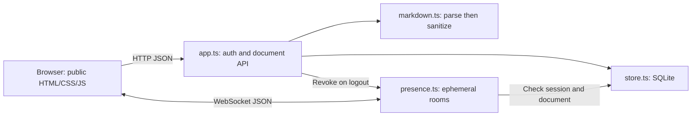
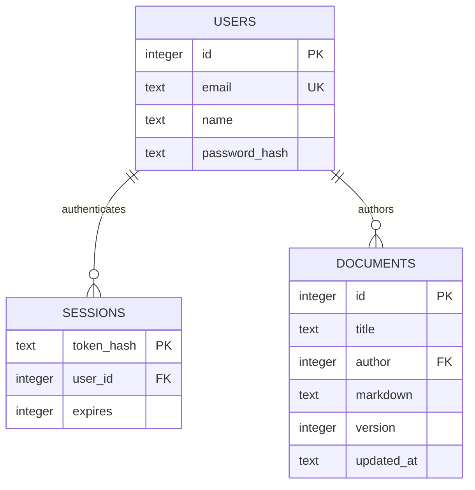

> **24 October update:** This document records the earlier Task 1 baseline. Projects, private permissions, invitations, Trash and Yjs live text editing are now implemented. See [COLLABORATION.md](COLLABORATION.md) and [VALIDATION.md](VALIDATION.md) for the current behaviour. Earlier statements that all accounts share every document or that CRDT editing is unimplemented are superseded. GitHub/submission evidence remains pending.

# MarkSync architecture and contracts

## Scope and assumptions

Task 1 is one trusted, authenticated group workspace running on one server. All registered users can read and edit all documents; the original author remains recorded. This is an explicit authorization policy to confirm with the customer. No per-document private access, concurrent character merge, offline durability, cloud deployment or production availability is claimed.



The browser renders returned sanitized HTML. The server keeps authentication and persistence authoritative. Presence depends only on the store's session and document lookup interface, so room transport can evolve without changing SQL save logic. Password derivation is asynchronous; SQLite operations are synchronous and short. This remains a small single-process service.

## Data model



The diagram uses descriptive hash names; actual SQL columns are `users.password` and `sessions.token`. They contain hashes, not plaintext credentials. The `session` cookie contains a random 32-byte token; only its SHA-256 digest is stored. Passwords use independent random salts and scrypt. Sessions expire after 24 hours and logout deletes the session. WAL and foreign keys are enabled; schema creation is idempotent. Future schema changes need explicit migrations.

## HTTP API

All `/api` responses disable caching. Mutating requests require an exact allowed Origin and JSON content. Every route except signup/login requires an unexpired cookie session.

| Method and path        | Input                    | Success                  | Main failure cases                           |
| ---------------------- | ------------------------ | ------------------------ | -------------------------------------------- |
| POST /api/signup       | name, email, password    | 200 user + cookie        | 400 invalid; 409 existing account; 429 limit |
| POST /api/login        | email, password          | 200 user + cookie        | 400 invalid; 401 incorrect; 429 limit        |
| GET /api/me            | Cookie                   | 200 user                 | 401 expired/absent                           |
| POST /api/logout       | Cookie                   | 200 ok; cookie cleared   | 401 expired; 403 origin                      |
| GET /api/documents     | Cookie                   | 200 shared document list | 401                                          |
| POST /api/documents    | title, markdown          | 201 document             | 400 invalid                                  |
| GET /api/documents/:id | Positive integer ID      | 200 document             | 400 invalid ID; 404 absent                   |
| PUT /api/documents/:id | title, markdown, version | 200 new version          | 400 invalid; 404 absent; 409 stale           |
| POST /api/preview      | markdown                 | 200 sanitized HTML       | 400 invalid                                  |

Title: 1-160 characters after nonblank validation; Markdown: at most 100,000 JavaScript string code units; body limit: 512 KiB to accommodate UTF-8 text; password: 12-128 characters; display name: 1-60. IDs and versions must be positive safe integers. Internal errors return a generic 500; malformed JSON returns 400. No sensitive exception details are returned.

## Save concurrency

```mermaid
sequenceDiagram
  participant A as Alice
  participant S as Server / SQLite
  participant B as Bob
  A->>S: GET document (version 1)
  B->>S: GET document (version 1)
  A->>S: PUT text A, version 1
  S-->>A: 200, version 2
  B->>S: PUT text B, version 1
  S-->>B: 409 conflict; no overwrite
```

The database executes a single conditional UPDATE with `WHERE id=? AND version=?`. Only one competing save from the same version succeeds. This is optimistic concurrency control, not OT or a CRDT. Bob can download his draft, load the latest stored version and manually reconcile. Unsaved text is not preserved if the page closes or the device crashes.

## WebSocket protocol

Connect to `/ws` on the same host using ws or wss according to the page scheme. The upgrade validates path, Origin and session. The browser sends `{"type":"join","documentId":1}`. The server broadcasts `{"type":"presence","users":[{"id":1,"name":"Alice"}]}` only to that room. Users are deduplicated across tabs. A socket can switch rooms; leaving updates its old room.

Browser application heartbeat: `{"type":"ping"}` -> `{"type":"pong"}` every 15 seconds while connected. Separately the server uses WebSocket control ping/pong every 30 seconds to detect dead peers. Expired or revoked sessions close with code 1008; malformed JSON closes with 1007; frames above 4096 bytes are rejected. Unknown events get an error response. Browser reconnection backs off from 1 second to a maximum of 15 seconds, rejoins the current room and does not discard editor contents.

## Boundaries to preserve in Task 2

Keep presence ephemeral. Introduce CRDT updates and durable snapshots in a separate collaboration module, with authorization on every transport path. Plan the migration from raw snapshots to CRDT state explicitly. Do not mix unrestricted raw-text overwrites with active CRDT editing. Test convergence under duplicate/reordered/delayed updates and recovery after disconnection; current Task 1 tests do not prove CRDT convergence.
